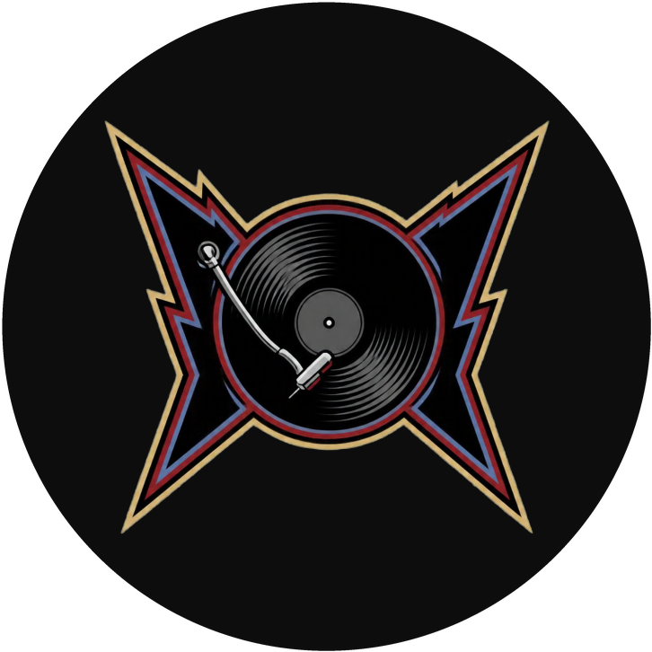

<h1 align="center">Rock Machine — Playlist Pública</h1>

<p align="center">
  
</p>

<p align="center">
  <em>Onde cada interação vira música.</em>
</p>

____________

Módulo responsável pela **publicação, armazenamento e reprodução pública das músicas** criadas na Rock Machine.

A funcionalidade permite que o usuário publique uma música informando seu nome e autor. O arquivo de áudio é armazenado no **Supabase Storage**, enquanto os dados da música são registrados no **MongoDB Atlas**.

A aplicação é disponibilizada publicamente através do **Render**, permitindo que a playlist seja acessada por qualquer pessoa através de uma URL ou QR Code.

## 🎯 Objetivo

A playlist pública foi desenvolvida para permitir que as músicas criadas na Rock Machine sejam:

- Publicadas pelos usuários;
- Armazenadas na nuvem;
- Registradas em um banco de dados;
- Reproduzidas diretamente pelo navegador;
- Acessadas publicamente pela internet;
- Compartilhadas através de um QR Code.

## 🏗️ Arquitetura

A funcionalidade utiliza diferentes serviços, cada um responsável por uma parte do sistema:

```text
                    USUÁRIO
                       │
                       ▼
              ┌─────────────────┐
              │     RENDER      │
              │                 │
              │ FastAPI + Front │
              └────────┬────────┘
                       │
              ┌────────┴────────┐
              │                 │
              ▼                 ▼
       ┌──────────────┐   ┌──────────────┐
       │  MongoDB     │   │   Supabase   │
       │    Atlas     │   │   Storage    │
       │              │   │              │
       │  Metadados   │   │ Arquivos WAV │
       └──────────────┘   └──────────────┘

````
## ☁️ Supabase Storage
O **Supabase Storage** é utilizado para armazenar os arquivos de áudio das músicas publicadas.

O projeto utiliza um bucket chamado:

    rock-machine_audios

Cada música recebe um nome único antes de ser enviada ao Storage, evitando conflitos entre arquivos.

Exemplo:

    8d6f2c9e-8d23-4c65-9c7f-1b3f8a9f1234.wav

Após o upload, o backend obtém a URL pública do arquivo.
Essa URL é posteriormente armazenada no MongoDB.

## 📁 Estrutura do Storage

    Supabase
    └── Storage
        └── rockmachine-audios
            ├── arquivo-1.wav
            ├── arquivo-2.wav
            ├── arquivo-3.wav
            └── ...

## 🗄️ MongoDB Atlas
O **MongoDB Atlas** é responsável por armazenar os dados relacionados às músicas.

O banco utilizado é:

    rock_machine
E a coleção:

    musicas
Cada documento representa uma música publicada.

Exemplo

```json
{
  "_id": "...",
  "nome": "Minha Música",
  "autor": "Esther",
  "url_audio": "https://...supabase.co/storage/v1/object/public/rockmachine-audios/arquivo.wav",
  "data_criacao": "2026-09-30T10:30:00"
}
```

## 🎧 Playlist

A página pública da playlist está disponível através da rota:

    /playlist

Exemplo:

    https://seu-projeto.onrender.com/playlist
